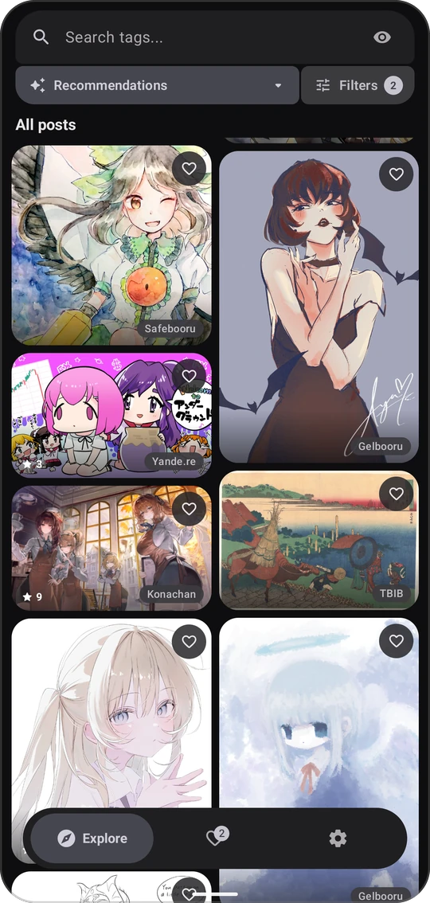
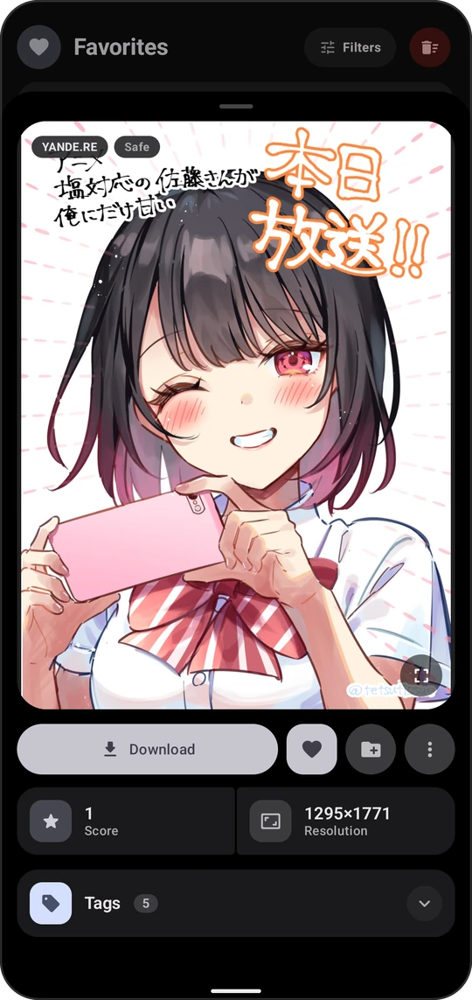
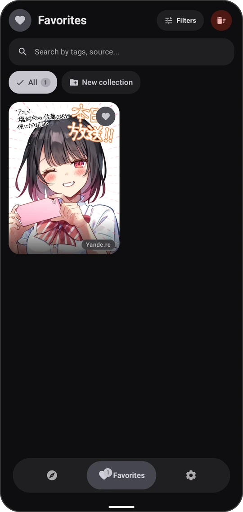
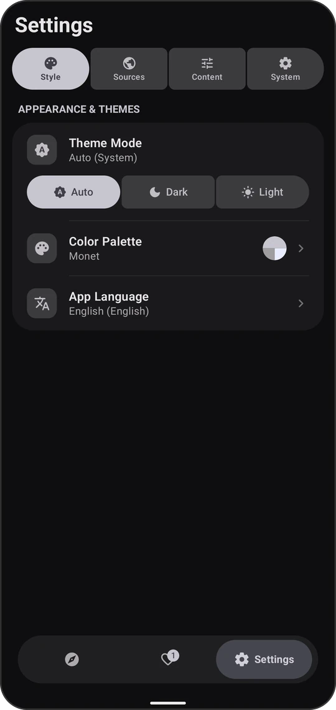

  

  
  
  

  <b>One feed for seven booru sites, with recommendations computed on your phone.</b> 
  No accounts, no analytics, no ads.

  <a href="https://github.com/weekanya/Booru/releases/latest"><b>Download APK</b></a>
  &nbsp;·&nbsp;
  <a href="https://booru.weebio.ru"><b>Website</b></a>
  &nbsp;·&nbsp;
  <a href="#features"><b>Features</b></a>

 

<table align="center">
  <tr>
    <td align="center" width="25%">
      
    </td>
    <td align="center" width="25%">
      
    </td>
    <td align="center" width="25%">
      
    </td>
    <td align="center" width="25%">
      
    </td>
  </tr>
  <tr>
    <td align="center"><b>Explore</b> Mixed feed from every source</td>
    <td align="center"><b>Post</b> Zoom, tags, download</td>
    <td align="center"><b>Favorites</b> Offline, with folders</td>
    <td align="center"><b>Settings</b> Themes, sources, privacy</td>
  </tr>
</table>

## Highlights

<table>
  <tr>
    <td width="50%" valign="top">
      <h3>✨ For you feed</h3>
      Posts from every enabled source in one feed. Recommendations are learned on the device from your favorites, searches, downloads and the posts you open. Recent interests count more than old ones.
    </td>
    <td width="50%" valign="top">
      <h3>🔍 Search and filters</h3>
      Multiple tags with autocomplete, tag categories and post counts. Filter by photos, videos or GIFs and by rating. Sort by newest, top score or random.
    </td>
  </tr>
  <tr>
    <td valign="top">
      <h3>🤖 No AI, no furry</h3>
      Hides AI-generated posts by their tags and by the generator metadata inside each file. A separate switch hides furry, anthro and feral posts.
    </td>
    <td valign="top">
      <h3>❤️ Favorites and stats</h3>
      Favorites are saved offline and sorted into folders. Stats cover everything you view, save, download and search: top characters, artists and series, activity by day and hour, and the tags shaping your feed.
    </td>
  </tr>
  <tr>
    <td valign="top">
      <h3>🎨 Material 3 Expressive</h3>
      Eight color palettes including Monet dynamic color. Light, dark and AMOLED modes. Tablets and foldables get a floating tab bar.
    </td>
    <td valign="top">
      <h3>🔒 Private by default</h3>
      No accounts or analytics. API keys are encrypted, and the app can be locked with your fingerprint. Content is hidden from recent apps and screenshots.
    </td>
  </tr>
</table>

## Features

<b>Sources</b>

 

- Rule34, Gelbooru, Realbooru, TBIB, Yande.re, Konachan and Safebooru.
- Add any custom Gelbooru, Moebooru or Danbooru site.
- Each source can be turned on or off.
- A slider sets the mix between new posts and recommendations.

<b>Viewer and video</b>

 

- Pinch to zoom, swipe between posts, swipe down to close.
- Tap a tag to search it, copy it or add it to the blacklist.
- Download the original, share, set as wallpaper or open in the browser.
- **Not interested** hides a post and shows fewer posts like it.
- Videos load in parallel chunks, so seeking is instant. Playback speed goes from 0.5x to 2x.

<b>Favorites and stats</b>

 

- Stored on the device, so they work offline.
- Folders, search by tag, and filters by type.
- Stats for today, the last 7 or 30 days, or all time, compared with the previous period, built from everything you view, favorite, download and search:
  - posts viewed, favorited and downloaded, and how much of what you open you save;
  - top characters, artists, series, tags and searches;
  - the tags your recommendations lean on right now;
  - activity by day or month, by time of day, and your longest streak;
  - content mix.
- History stays on the device, is not recorded in incognito mode, and can be cleared in settings.

<b>Offline posts</b>

 

- Keep 100 to 500 posts from your current feed, search and filters, including GIFs and videos. Posts you already have are never downloaded twice.
- Downloads keep running in the background with a progress notification.
- Watch them later without internet, with filters for images, GIFs and videos.
- Find it in **Settings → Content → Offline posts**, or open it from the error card when there is no connection.

<b>Data and quality</b>

 

- Image quality: Auto, Original, Optimal or Saver.
- **Auto** loads originals on Wi-Fi and switches to lighter images on mobile data.
- A tag blacklist that applies to every source.

<b>Privacy</b>

 

- No analytics, ads or accounts.
- API keys stored with Android encrypted storage.
- Fingerprint app lock with a timeout you can set.
- Incognito mode: searches and views are not remembered.
- The app is hidden from recent apps and screenshots.

<b>Languages and updates</b>

 

- English, Russian, Japanese, Chinese, Korean and Arabic.
- Built-in updater from GitHub Releases. It checks the APK signature before installing.

